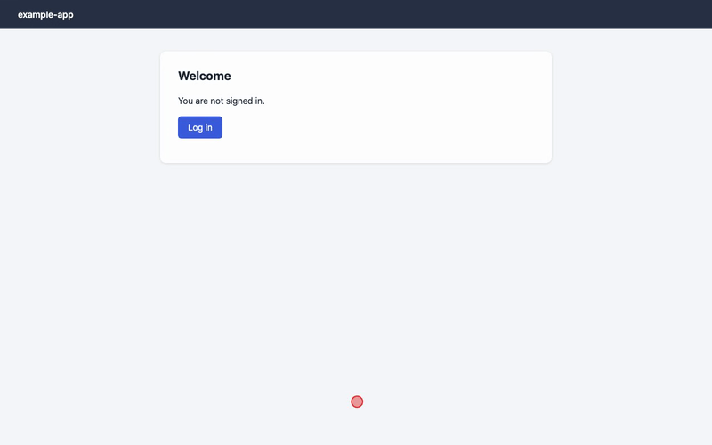
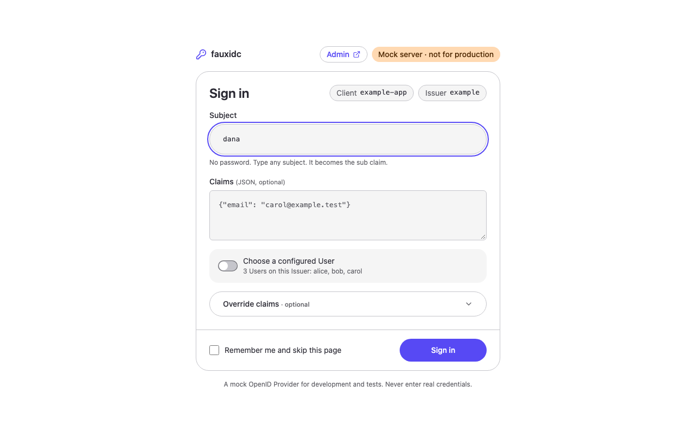
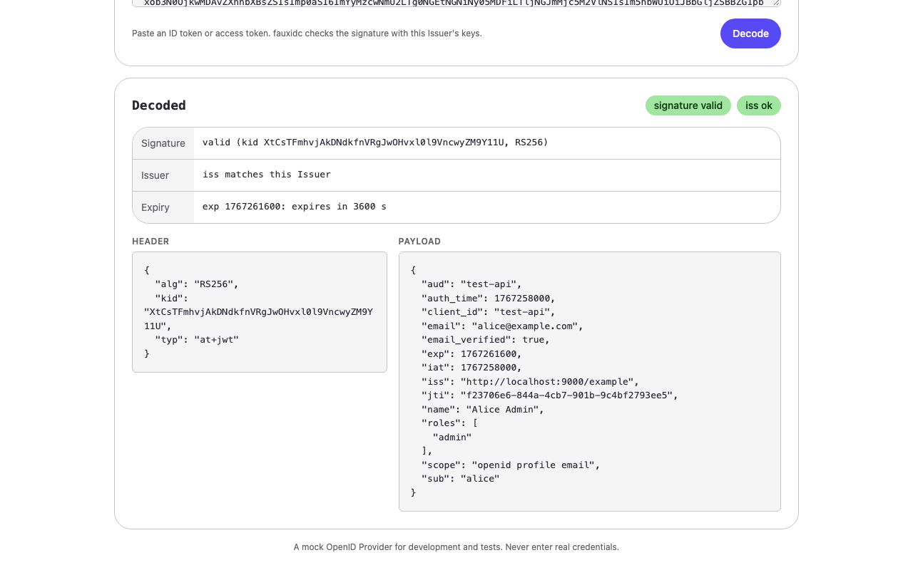
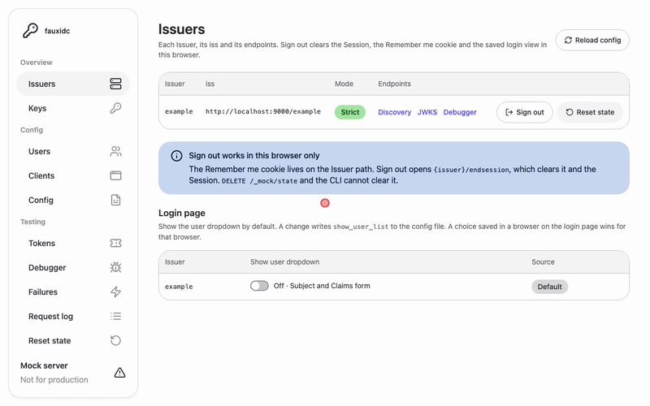

# fauxidc

[](https://github.com/schmas/fauxidc/actions/workflows/ci.yml)
[](https://github.com/schmas/fauxidc/actions/workflows/conformance.yml)
[](https://github.com/schmas/fauxidc/releases)
[](https://github.com/schmas/fauxidc/pkgs/container/fauxidc)

fauxidc is an OAuth 2.0 / OpenID Connect mock server for local development and integration tests.
Website and docs: [schmas.github.io/fauxidc](https://schmas.github.io/fauxidc/).

<p align="center"></p>

Give your app a real login flow and real signed tokens, with one small binary and no setup.



## Why fauxidc

- **Single binary.** One binary written in Rust, with a small footprint. On macOS arm64 the release binary is 3.3 MB and uses 5.6 MiB of memory at idle. The linux/arm64 container image is 6.3 MB. See [Footprint](docs/footprint.md).
- **No infrastructure.** No database, no external service, no account. It starts in Zero config with one command.
- **Real signed tokens.** Signed JWTs (RS256 by default), discovery, JWKS, PKCE, refresh tokens and Sessions, as a real provider gives.
- **Test API.** Mint tokens without a browser, inject failures, rotate keys and read the Request log under `/_mock/`.
- **OpenID conformance in CI.** Every pull request and every push to `main` runs the OpenID Foundation conformance suite.

It is pre-alpha: the config and the library API can change before 1.0.
Anyone who can reach a fauxidc server can mint tokens, so never trust a fauxidc Issuer in production.
See [SECURITY.md](SECURITY.md).

> fauxidc was designed and built with AI coding agents (Claude Code), under human direction and review. Every change passes the test suite, clippy, and the OpenID conformance suite in CI. Report problems in GitHub issues.

## Start in 60 seconds

Start the server with Docker:

```sh
docker run --rm -p 9000:9000 ghcr.io/schmas/fauxidc
```

Or download the binary from the [GitHub releases](https://github.com/schmas/fauxidc/releases).
The targets are `x86_64-unknown-linux-musl`, `aarch64-unknown-linux-musl`, `x86_64-apple-darwin` and `aarch64-apple-darwin`.
Each archive has a `.sha256` file next to it. This example is for an Apple silicon Mac:

```sh
gh release download --repo schmas/fauxidc --pattern '*aarch64-apple-darwin.tar.gz'
tar -xzf fauxidc-*-aarch64-apple-darwin.tar.gz
sudo mv ./fauxidc-*-aarch64-apple-darwin/fauxidc /usr/local/bin/   # put it on your PATH
fauxidc
```

If macOS blocks a binary that a browser downloaded, run `xattr -d com.apple.quarantine /usr/local/bin/fauxidc`.

Or install it from crates.io with Cargo (needs Rust 1.98 or newer):

```sh
cargo install fauxidc --locked
```

Or build it from source, from the Git repository:

```sh
cargo install --git https://github.com/schmas/fauxidc --locked
```

Add `--tag v0.1.0` (or another release tag) to the `--git` command to pin a version.
The archive also has the `examples/` directory. From a checkout, use `cargo run --` in place of `fauxidc`.


With no config, fauxidc starts in Zero config mode: one Issuer `default` in Lenient mode,
one public Client `test`, and the Users `alice` and `bob`. In a second terminal:

```sh
# Discovery document
curl -s http://localhost:9000/default/.well-known/openid-configuration
# Tokens for alice, without a browser
curl -s http://localhost:9000/_mock/default/token -H 'content-type: application/json' -d '{"user": "alice"}'
# Health check
curl -s http://localhost:9000/_mock/health
```

Point your app at the Issuer URL `http://localhost:9000/default` with the client id `test`.
Open `http://localhost:9000/default/debugger` and click "Run login flow" to see the login page.
The page opens on the Custom user form (Subject and Claims). Use the switch "Choose a configured User" to pick a User from a dropdown.
To open the page on the dropdown, set `show_user_list = true` on the Issuer, or use the Login page switch in the dashboard.

## Screenshots

| Login page | Debugger | Dashboard |
| --- | --- | --- |
| [](docs/media/login-page.png) | [](docs/media/debugger.png) | [](docs/media/dashboard.png) |

## Recipes

[docs/recipes.md](docs/recipes.md) has the recipes. They use [examples/generic.toml](examples/generic.toml). Start fauxidc with it:

```sh
# Docker: the image has the examples in /examples/
docker run --rm -p 9000:9000 ghcr.io/schmas/fauxidc --config /examples/generic.toml
# Binary: download the file (the release archive has it in examples/ too)
curl -sO https://raw.githubusercontent.com/schmas/fauxidc/main/examples/generic.toml
fauxidc --config generic.toml
# Checkout
cargo run -- --config examples/generic.toml
```

- [SPA with PKCE](docs/recipes.md#spa-with-pkce)
- [Backend with a client secret](docs/recipes.md#backend-with-a-client-secret)
- [Machine-to-machine](docs/recipes.md#machine-to-machine)
- [Mint a token in a test](docs/recipes.md#mint-a-token-in-a-test)
- [Fixed time for reproducible tokens](docs/recipes.md#fixed-time-for-reproducible-tokens)
- [Random host port (Testcontainers)](docs/recipes.md#random-host-port-testcontainers), with the JVM guide [docs/testcontainers.md](docs/testcontainers.md)
- [Simulate a provider outage](docs/recipes.md#simulate-a-provider-outage)
- [Use with an agent](docs/recipes.md#use-with-an-agent)

## Use with an AI coding agent

The repo has two agent skills: [skills/fauxidc](skills/fauxidc/SKILL.md) (reference) and
[skills/fauxidc-setup](skills/fauxidc-setup/SKILL.md) (adds fauxidc to an app project).
Copy or symlink a skill directory into `.claude/skills/` (one project), `~/.claude/skills/` (all projects, Claude Code)
or `~/.agents/skills/` (other agents that read it). [llms.txt](llms.txt) lists the docs.
[docs/agents.md](docs/agents.md) has the install steps and prompts to copy, for example:

```text
Write an integration test for GET /api/orders of our API. Start fauxidc with examples/generic.toml.
Before the request, mint an access token with the Test API: POST http://localhost:9000/_mock/generic/token
with {"user": "alice", "audience": "https://api.example.test"}. Send it as a Bearer token and expect 200.
```

## Configuration

fauxidc reads five sources. A later source overrides an earlier one:
built-in defaults, config files (`--config`, `FAUXIDC_CONFIG` or `./fauxidc.toml`),
inline config (`FAUXIDC_CONFIG_INLINE`), env vars for single keys (`FAUXIDC__SERVER__PORT=9000`) and CLI flags.
Every source rejects unknown keys. Invalid config stops the server with exit code 2.
`fauxidc config` prints the merged config, `--check` only validates it and `--schema` prints the JSON Schema.

The [examples/](examples/) directory has six configs and a compose file:
`auth0.toml`, `okta.toml`, `generic.toml`, `keycloak.toml`, `entra.toml`, `cognito.toml` and `docker-compose.yml`.
Each one imitates the paths and claims of one provider style.

[docs/configuration.md](docs/configuration.md) has the details: the sources table, Zero config, a small config, the editor schema line, Docker,
the examples, Strict and Lenient mode, the Issuer URL rules and the signing keys.
The full key reference is [docs/spec.md](docs/spec.md), section 5.

## Test API

The Test API lives under `/_mock/` and has no authentication. It mints tokens, rotates keys, adds and removes Injected failures,
changes Users and Clients, shows the running config, resets the runtime state, reloads the config files and shows the Request log.
[docs/test-api.md](docs/test-api.md) has every route, field, status code and limit.

Open `http://localhost:9000/_mock/` (or `/`) in a browser for the [dashboard](docs/test-api.md#dashboard).
It does each of these operations with a form and signs you out of an Issuer.
Here it makes the next token request fail with 503, and the app shows the error:



## Templates

You can replace the login page, the error page, the signed-out page, the debugger page, the `form_post` page and the dashboard with your own templates.
The built-in pages link one embedded stylesheet, `/_mock/static/halo.css` (plain CSS, light and dark), and need no network.
The login page opens on the Custom user form. The switch "Choose a configured User" shows the dropdown of the configured Users.
See [docs/features.md](docs/features.md#login-page) for the login page view and the [Custom user template](docs/features.md#custom-user-template),
and [docs/templates.md](docs/templates.md) for the template context (version 3).

## Debugger

Each Issuer serves a debugger page at `{issuer}/debugger`.
Paste a JWT to decode it and check its signature, `exp` and `iss`.
Or click "Run login flow" to run the code flow with PKCE and see the decoded tokens.
The dashboard Debugger view (`/_mock/#debugger/<issuer id>`) shows the same page in a frame.
See [docs/features.md](docs/features.md#debugger).

## TLS

A build with the optional `tls` feature serves HTTPS from PEM files that you provide.
The release binaries and the container image are built without it. See [docs/features.md](docs/features.md#tls).

## Hot reload

fauxidc polls the config files every second and also reloads on SIGHUP.
A change applies only after two polls in a row see the same new file state, so it applies 1 to 2 s after the save.
`POST /_mock/reload` applies it at once. See [docs/features.md](docs/features.md#hot-reload).
Sessions, token exchange, `private_key_jwt` and the [footprint](docs/footprint.md) are in `docs/` too.

## Conformance

CI runs two plans of the OpenID Foundation conformance suite against fauxidc on each push to `main`:
`oidcc-basic-certification-test-plan` (Basic OP, static Clients) and `oidcc-config-certification-test-plan` (Config OP).
Each run uploads the suite's result export as the `conformance-results` artifact.
See [conformance/README.md](conformance/README.md) for the known results and how to run the suite locally.

## Not supported

These are not planned (spec non-goals):

- Production use.
- Provider management APIs, for example the Auth0 Management API or the Okta Users API.
- RFC 7591 dynamic client registration, RFC 9126 PAR, RFC 9449 DPoP, RFC 8628 device flow,
  front-channel and back-channel logout.
- The implicit grant and the password grant.

Current limits:

- `jwks_uri` must be an `http://` URL.
- The `tls` feature uses the PEM files you give. fauxidc does not generate certificates.
  See [Local certificate with mkcert](docs/features.md#local-certificate-with-mkcert).

## License

Licensed under either of [Apache License, Version 2.0](LICENSE-APACHE) or [MIT license](LICENSE-MIT), at your option.
