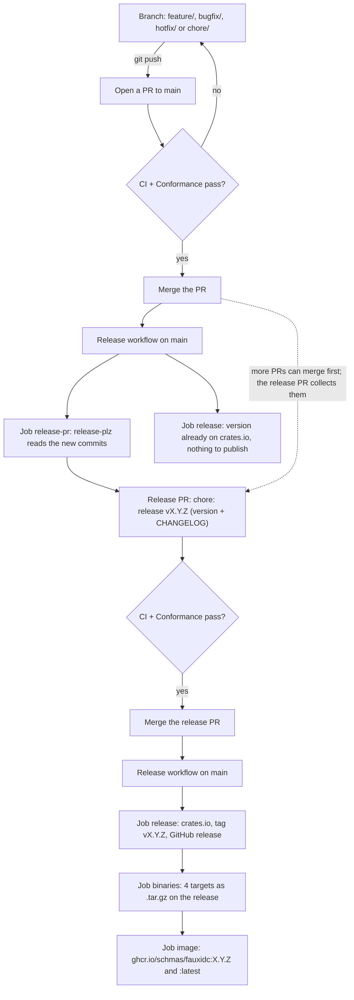

# Releasing

`release-plz` (version 0.4.3) makes every release from the commits on `main`.
Nobody starts a release by hand: merging the release PR publishes the release.

## Flow

- A normal PR never publishes. Its merge opens or updates the release PR.
  Several PRs can merge before one release. The release PR collects all of them.
- The merge of the release PR is the only step that publishes. A crates.io version cannot be deleted,
  so merge the release PR only when the version and the CHANGELOG are correct.
- If you do not want a release yet, leave the release PR open. Each merge to `main` updates it.
- A release PR appears only when files of the published crate change. A change only in `.github/`
  gives no release PR.

## Version

`release-plz` reads the [Conventional Commit](https://www.conventionalcommits.org/) types since the last release.

| Commit type | Bump before 1.0 | Bump from 1.0 |
|---|---|---|
| `fix:`, `perf:`, other types that change the crate | patch | patch |
| `feat:` | patch | minor |
| `feat!:` or a `BREAKING CHANGE` footer | minor | major |

A pre-release version (with a `-`, for example `0.2.0-rc.1`) gets no `:latest` image tag and is marked as
a pre-release on GitHub.

## Rules on main

- Changes reach `main` only through a PR. The ruleset `protect-main` blocks direct pushes for everyone,
  admins included. Force pushes and branch deletion are also blocked.
- A PR needs no approval. These checks must pass: `fmt`, `clippy`, `test (ubuntu-latest)`,
  `test (macos-latest)`, `deny`, `tls`, `msrv`, `musl`, `css`, `spa-e2e`, `conformance`.

## Tokens

- GitHub starts no workflows for events that `GITHUB_TOKEN` causes. So the `release-pr` job opens the
  release PR with a token of the GitHub App `schmas-fauxidc-release` (secrets `RELEASE_APP_CLIENT_ID` and
  `RELEASE_APP_KEY`). CI and Conformance then run on the release PR like on any other PR.
- crates.io publishing uses trusted publishing: the `release` environment and `id-token: write`.
  No registry token secret exists.

## Time

| Step | Usual time |
|---|---|
| CI and Conformance on a PR (in parallel) | about 4 minutes |
| Release workflow with nothing to publish | under 1 minute |
| Release workflow with a publish | 3 to 4 minutes |
